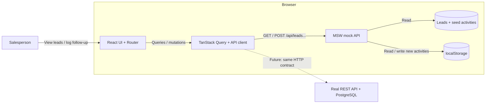

# System design: Sales Lead Management Tool

Scenario C: Demand. Frontend implementation with a mocked backend.

The application lets salespeople review website leads, inspect contact history, and record completed follow-ups. The design focuses on those workflows instead of production infrastructure.

## 1. Requirements, scope, and assumptions

| Requirement      | Implementation                                                                                                       |
| ---------------- | -------------------------------------------------------------------------------------------------------------------- |
| Lead Inbox       | `/leads`: newest-first list, 10 leads per page, and name search across all leads.                                    |
| Lead Details     | `/leads/:leadId`: full contact/inquiry details and timestamp-ordered history; newest/oldest sorting and "Load more". |
| Activity Logging | Call/Email/Message modal with a note; persist to localStorage and refresh history.                                   |

Assumptions:

- Website leads are fictional fixtures. Live website ingestion is outside the demo.
- "Full details" means name, email, phone, inquiry, and received time. Missing contacts display "Not provided"; IDs identify records and URLs.
- Follow-ups are completed activities, not appointments. Timestamps are assigned on save; history defaults to newest-first.
- Persistence survives reload in the same browser profile/origin while localStorage is available and uncleared. It does not sync across devices or users.

Execution: both `npm run dev` and `npm run build` followed by `npm run preview` run the mocked demo. MSW is enabled by default; set `VITE_ENABLE_MOCKING=false` to use a real API. See the [README](../README.md#installation-and-running-locally).

Out of scope: authentication/authorization, editing/deleting leads, real email/SMS, real-time collaboration, and production deployment. Frontend plus mock backend follows Part 2. Production would need HTTPS, server-side authorization/validation, and retention/backup; localStorage is not suitable for real customer data or authentication tokens.

## 2. Architecture and component roles

Solid arrows show the demo. The dashed arrow shows the planned backend replacement, not a runtime fallback.

| Component                   | Role                                                                                                             |
| --------------------------- | ---------------------------------------------------------------------------------------------------------------- |
| React UI + Router           | Navigation, request states, and dedicated timeline/modal/recovery components.                                    |
| TanStack Query + API client | Cache by page/search/lead/sort, manage history/mutations, send JSON, normalize errors, and log request metadata. |
| MSW                         | Intercept HTTP requests, start before UI renders, and reuse handlers in tests.                                   |
| Fixtures                    | Fictional leads and seed activities, kept separate from saved data.                                              |
| Activity persistence module | Validate, merge seed/saved history, sort, paginate, and read/write localStorage.                                 |

MSW is not a standalone backend server. Handlers and persistence run in the browser. The HTTP contract is the seam for replacing it with a real backend while keeping the UI/query logic. Query cache is not persistence.

## 3. Data model and API contract

| Record         | Fields                                                                    |
| -------------- | ------------------------------------------------------------------------- |
| `Lead`         | `id`, `name`, nullable `email`/`phone`, `message`, `createdAt`            |
| `LeadActivity` | `id`, `leadId`, nullable `type` (call/email/message), `note`, `createdAt` |

A Lead has many activities through `leadId`. Timestamps are ISO UTC and display in the browser timezone. Null activity type means "not recorded", never inferred. Types live in `src/types/api.ts`.

| Endpoint                             | Input                                                                            | Response                           |
| ------------------------------------ | -------------------------------------------------------------------------------- | ---------------------------------- |
| `GET /api/leads`                     | `page`, `pageSize`, optional `search` (trimmed, case-insensitive name substring) | `{ items, total, page, pageSize }` |
| `GET /api/leads/:leadId`             | Lead ID                                                                          | Lead or `null`                     |
| `GET /api/leads/:leadId/activities`  | `sort=newest\|oldest`, `limit`, optional `cursor`                                | `{ items, nextCursor }`            |
| `POST /api/leads/:leadId/activities` | `{ type, note }`                                                                 | HTTP 201 and saved activity        |

Activity endpoints return 404 for unknown leads, 400 for invalid input/cursors, 409 for unreadable storage, and 500 for write failure. History uses timestamp/ID ordering; cursors belong to one lead and sort direction.

## 4. Data flow

1. Inbox/search: `/` redirects to `/leads`, requests page/search, then MSW filters all fixtures, sorts newest-first, and paginates. The UI renders the matches and total. Changing search resets to page one; clearing it restores the full list.
2. Detail/history: the UI fetches lead and history separately. The handler merges seed/saved activities, filters by lead, and returns a batch. "Load more" sends the cursor; changing sort changes the query key.
3. Save: the form checks for a nonblank note. POST validates lead/type/note, creates an ID/timestamp, and writes storage. The endpoint returns 201 only after successful persistence. The UI then resets/refetches history and closes the modal. Failure keeps the draft; unsaved activities are not inserted optimistically.

## 5. Technologies and trade-offs

| Technology                       | Justification                                                                      |
| -------------------------------- | ---------------------------------------------------------------------------------- |
| React 19 + TypeScript            | Component-based UI with typed contracts.                                           |
| Vite + React Router              | Lightweight SPA build/dev tooling, direct URLs, lazy routes, and error boundaries. |
| TanStack Query + Table           | Server-state cache, history batches, mutations, and API-owned pagination.          |
| MSW + localStorage               | Testable HTTP mocks and reload persistence without backend setup.                  |
| Tailwind CSS + Heroicons         | Reusable UI following `DESIGN.md` and reference HTML.                              |
| Vitest + Testing Library + jsdom | Behavior and persistence tests.                                                    |
| Oxlint + Prettier                | Static checks and consistent formatting.                                           |

The mock keeps the assessment focused on frontend behavior. It does not prove backend performance and does not provide secure storage, backup, or multi-user transactions. These workflows do not need microservices, queues, or distributed caches.

## 6. Build for the future

Future changes are not implemented; add them only when needed.

| Concern                   | Current design / limit                                                                                | Minimal next step                                                                                              |
| ------------------------- | ----------------------------------------------------------------------------------------------------- | -------------------------------------------------------------------------------------------------------------- |
| Scalability & performance | Pagination, history cursors, 60-second cache, lazy routes; browser still scans/sorts storage.         | REST + PostgreSQL, DB pagination, index `(lead_id, created_at, id)`; compact page controls for large datasets. |
| Reliability               | Validation, retained drafts, manual retry, explicit storage reset; multi-tab writes can lose updates. | Typed error codes, DB transactions, idempotency before automatic write retry.                                  |
| Maintainability           | Separate features/UI/persistence, shared contracts/client, reusable handlers/tests.                   | Backend contract tests and CI for tests/lint/format/type-check/build.                                          |

## 7. Observability strategy

Implemented: the API client emits one structured console event for each completed or failed request: `method`, safe route template, HTTP `status` (`null` without a response), and `durationMs`. It covers HTTP/network failures without changing error handling. UI feedback and error boundaries help with troubleshooting. Console logging is not centralized monitoring.

Next steps:

- Logging/errors: collect request events and uncaught frontend errors when deployed; add persistence error codes and correlation IDs if needed.
- Metrics: track latency/error rate, save success/failure, and storage failures; alert on sustained changes from an observed baseline.
- Tracing: correlate submit, POST, persist, and refetch; add backend trace context/OpenTelemetry only when cross-layer diagnosis warrants it.

Logs exclude request/response bodies, headers, query values, and lead IDs. Known routes use templates such as `/leads/:leadId`; unknown routes use `/other` to avoid leaking sensitive paths.

## 8. AI Collaboration Narrative

I used GenAI as an engineering assistant while building and documenting this submission. I kept ownership of the scope, implementation choices, review, verification, and final content.

The collaboration worked best in small steps. I used AI to help implement and refine the Scenario C workflows: lead inbox, lead detail, activity history, and follow-up recording. Repository guidance in `AGENTS.md`, UI rules in `DESIGN.md`, the reference HTML, and existing shared components kept the output tied to this codebase instead of generic patterns.

Important corrections came from review rather than accepting generated output as final:

- Removed the intermediate Lead status field and filter because they were outside Scenario C's required scope.
- Centralized follow-up validation so the mock API and persistence layer use the same rules.
- Migrated legacy saved activities with `type: null` instead of inventing historical activity types.
- Split the Lead Detail route into smaller feature components for the timeline, follow-up modal, recovery card, and contact display.
- Kept implemented behavior separate from future backend, telemetry, and production-readiness plans.

AI also helped compare the assessment PDF with the source code and turn the current implementation into this system design. That review clarified the architecture, data flow, API contract, trade-offs, and known limits. It was an iterative documentation and design check, not a claim that every design choice was made before coding.

Verification used automated checks during development, including tests, linting, formatting checks, and builds. Browser-only checks such as real reload persistence, keyboard flow, and responsive layout were reviewed manually during development.

Part 1 coverage: diagram/roles (§2), data flow (§4), technologies/justifications (§5), observability (§7), GenAI (§8), assumptions (§1), and future readiness (§6). Working code/README/tests and the 5-10 minute video remain separate deliverables.
